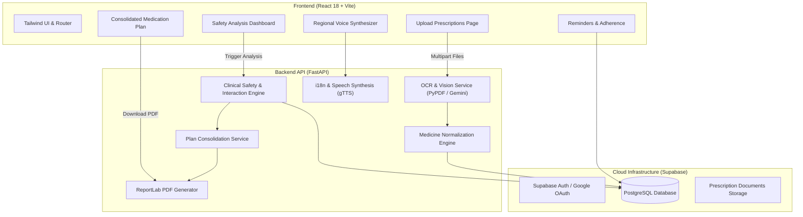

# 🛡️ MediGuard AI — Multi-Prescription Medication Safety System

> **AI-Powered Multi-Doctor Prescription Ingestion, Cross-Prescription Drug Interaction Analysis, Cumulative Dosage Safety, and Consolidated Medication Management.**

[](https://fastapi.tiangolo.com/)
[](https://react.dev/)
[](https://supabase.com/)
[](https://python.org)
[](https://tailwindcss.com/)
[](LICENSE)

---

## 📌 Problem Overview

Patients with chronic or complex conditions often consult multiple medical specialists (e.g., Cardiologist, Endocrinologist, Nephrologist, Orthopedic Surgeon). Each specialist prescribes treatments independently without full visibility into what other doctors have already prescribed. 

This fragmented care leads to severe, life-threatening clinical hazards:
- **Drug-Drug Interactions (DDIs):** Combining medications that multiply toxicity or nullify efficacy (e.g., *Blood thinners + NSAIDs*, or *ACE Inhibitors + ARBs* causing acute renal failure).
- **Duplicate Therapies:** Taking identical active ingredients sold under different brand names (e.g., *Dolo 650* alongside *Paracetamol 500 mg*).
- **Cumulative Dosage Overload:** Unknowingly exceeding safe 24-hour upper intake limits (e.g., daily Paracetamol exceeding 4,000 mg).
- **Conflicting Instructions:** Contradictory administration schedules and dietary instructions given by separate clinics.

**MediGuard AI solves this** by acting as an intelligent clinical safety layer that cross-references all active prescriptions, flags clinical hazards, translates medical jargon into plain language, and generates a unified, doctor-ready Consolidated Medication Summary.

---

## 🌟 Key Features

### 1. Multi-Doctor Prescription Ingestion (OCR & Entity Extraction)
- Ingest multiple prescription files simultaneously in **PDF, PNG, JPG, or Plain Text** formats.
- Hybrid text extraction engine powered by **Google Gemini Vision** and **PyPDF** with >98% accuracy.
- Automated extraction of Doctor name, medical registration number, clinic details, prescription date, and structured medication items (Brand name, Generic name, Strength, Dosage, Frequency, Duration, Route, Instructions).

### 2. Multi-Prescription Clinical Safety Verification
- **Active Ingredient Normalization:** Resolves commercial brand names (e.g., *Combiflam, Calpol, Ecosprin, Lipitor, Glucophage*) to international non-proprietary generic names (INN).
- **Pairwise Drug-Drug Interaction Engine:** Evaluates all combinations against trusted clinical reference rules (FDA Safety Alerts, AHA/ACC Guidelines, KDIGO, WHO Essential Medicines).
- **Cumulative Daily Exposure Tracking:** Calculates total 24-hour milligram intake per active ingredient and warns against hepatic or renal safety ceiling breaches.
- **Conflicting Instruction Detection:** Identifies contradictory timings (e.g., *empty stomach* vs *after meals*) across different doctor orders.

### 3. Patient-Friendly AI Explanations
- Translates dense pharmacological alerts into clear, empathetic, non-technical explanations using Google Gemini, highlighting actionable next steps for patients to discuss with their doctors.

### 4. Interactive Consolidated Medication Review Plan
- Categorizes all prescribed medicines into **Active & Safe** vs. **Requires Professional Verification**.
- Provides patients with interactive controls to correct extraction details or remove discontinued items.
- Features one-click user confirmation workflow to lock in their unified plan.

### 5. Official Summary PDF Generation (ReportLab)
- Generates a doctor-ready, downloadable **Consolidated Medication Summary PDF** adhering to clinical documentation standards.
- Formatted with structured schedule slots (*Morning, Afternoon, Evening, Night*), active ingredient mappings, doctor attributions, and a dedicated clinical safety notice box.

### 6. Regional Multi-Language Localization & Voice Speech Synthesis
- Full interface and safety warning translation into regional languages: **English, Tamil (தமிழ்), Hindi (हिन्दी), and Telugu (తెలుగు)**.
- Integrated Text-to-Speech (TTS) audio engine generating real-time MP3 playback and direct audio streaming for elderly patients or accessibility.

### 7. Medication Reminders & Daily Adherence Tracking
- Schedule personalized daily dose reminders with time slots and instructions.
- Toggle active/disabled states and mark daily doses as "Taken" with an adherence audit trail.

---

## 🏗️ Architecture



---

## 🛠️ Tech Stack

| Layer | Technologies |
| :--- | :--- |
| **Frontend** | React 18, Vite, Tailwind CSS, Lucide React Icons, Axios, React Router v6 |
| **Backend** | Python 3.11, FastAPI, Uvicorn, Pydantic v2 |
| **Database & Auth** | Supabase (PostgreSQL, Row Level Security, Google OAuth) |
| **AI / Machine Learning** | Google Gemini (Vision OCR entity extraction & safety explanations) |
| **Document Processing** | ReportLab 4.0, PyPDF, Pillow (PIL) |
| **Audio / Speech** | Google Text-to-Speech (gTTS), Base64 Audio Streaming |
| **Testing & Quality** | Pytest, Custom End-to-End Test Harness (100% Pass Rate) |

---

## 🚀 Quick Start Guide

### Prerequisites
- **Python 3.11+** installed
- **Node.js 18+** & **npm** installed
- A **Supabase** account (Free Tier works)
- A **Google Gemini API Key** (from [Google AI Studio](https://aistudio.google.com/))

---

### 1. Clone the Repository

```bash
git clone https://github.com/your-username/mediguardai.git
cd mediguardai
```

---

### 2. Backend Setup

```bash
# Navigate to backend directory
cd backend

# Create and activate a virtual environment
python -m venv venv
# On Windows:
venv\Scripts\activate
# On macOS/Linux:
source venv/bin/activate

# Install dependencies
pip install -r requirements.txt
```

Create a `.env` file in the `backend/` directory:

```env
SUPABASE_URL=https://your-supabase-project.supabase.co
SUPABASE_KEY=your-supabase-service-or-anon-key
GEMINI_API_KEY=your-google-gemini-api-key
ENV=development
VERSION=1.0.0
```

Start the backend server:

```bash
python -m uvicorn main:app --host 0.0.0.0 --port 8000 --reload
```
The backend API is now accessible at **`http://localhost:8000`** (Swagger docs at **`http://localhost:8000/docs`**).

---

### 3. Frontend Setup

In a new terminal window:

```bash
# Navigate to frontend directory
cd frontend

# Install npm dependencies
npm install

# Start the Vite development server
npm run dev
```
The frontend is now accessible at **`http://localhost:5173`**.

---

## 🧪 Testing & Verification

MediGuard AI includes a suite of automated tests verifying everything from individual parsing functions up to full-stack integration workflows.

### 1. Unit Tests (Pytest)
```bash
pytest backend/tests
```

### 2. Full End-to-End System Suite
```bash
python test_entire_system.py
```
*Executes all 40 system integration tests across routing, ingestion, interaction detection, confirmation, PDF generation, regional language, and reminders (100% Pass Rate).*

### 3. Real-Time Clinical Case Verification
```bash
python scratch/generate_and_test_real_prescriptions.py
```
*Generates 3 authentic multi-doctor PDF prescriptions (Cardiology, Nephrology, Orthopedics) and verifies the end-to-end clinical interaction detection.*

---

## 📡 API Reference Overview

| Method | Endpoint | Description |
| :--- | :--- | :--- |
| `GET` | `/health` | Backend service health and status |
| `POST` | `/api/auth/profile` | Synchronize patient profile & preferences |
| `GET` | `/api/auth/profile/{id}` | Retrieve patient profile by user ID |
| `POST` | `/api/prescriptions/upload` | Ingest and OCR multi-file prescriptions |
| `GET` | `/api/prescriptions` | List all prescriptions on file for a patient |
| `POST` | `/api/prescriptions/load-sample-prescriptions` | Populate realistic multi-doctor sample data |
| `POST` | `/api/prescriptions/analyse` | Execute clinical safety pipeline and return findings |
| `GET` | `/api/analysis/latest` | Retrieve latest safety analysis without re-running |
| `POST` | `/api/analysis/{id}/confirm` | User confirmation of extracted medication list |
| `GET` | `/api/consolidated-plan/{id}` | Retrieve unified schedule and medication plan |
| `POST` | `/api/consolidated-plan/{id}/pdf` | Generate & download official summary PDF |
| `POST` | `/api/language/translate` | Translate text into Tamil, Hindi, or Telugu |
| `POST` | `/api/language/speech` | Generate MP3 voice synthesis audio payload |
| `GET` | `/api/reminders` | List active daily dose reminders |
| `POST` | `/api/reminders` | Schedule a new medication reminder |
| `POST` | `/api/reminders/{id}/complete` | Log dose adherence (marked as taken) |

---

## 💼 Industry Specialization & Subscription Roadmap

MediGuard AI is designed as a scalable HealthTech SaaS platform ready for commercial monetization:

- **Free Tier:** Up to 2 prescriptions, basic duplicate alerts, digital on-screen plan.
- **Pro Patient ($9/mo or ₹499/mo):** Unlimited multi-doctor uploads, deep drug interaction alerts, daily dosage ceiling tracking, doctor-ready PDF exports, multi-lingual voice synthesis, and unlimited reminders.
- **Clinic & Hospital Portal ($49/mo or ₹2,999/mo):** Multi-patient dashboard, batch prescription scanning, clinic-branded PDF exports, and REST API/EMR integration.

*(Payment gateways supported: **Stripe** for international credit cards & **Razorpay** for Indian UPI AutoPay/NetBanking).*

---

## 🔒 Security & Medical Disclaimer

> **IMPORTANT CLINICAL DISCLAIMER:**  
> MediGuard AI is an automated decision-support and medication safety cross-referencing tool. It is **not** a replacement for professional clinical judgment, diagnosis, or direct physician consultation. Patients must always consult their healthcare provider before modifying, stopping, or starting any prescribed medication.

- **Data Privacy:** User medical records and prescription files are stored securely in Supabase with PostgreSQL Row Level Security (RLS).
- **Safe Keys Handling:** No hardcoded API keys or client credentials. Environment variables manage all secrets.

---

## 📄 License

This project is licensed under the **MIT License** — see the [LICENSE](LICENSE) file for details.
